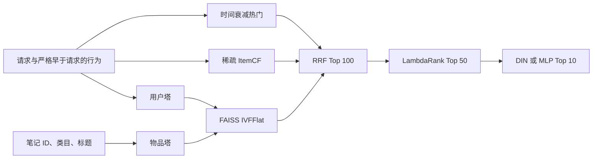

# QilinRec

**A Multi-Stage Recommendation System**。一个用 Qilin 推荐日志训练、检索和评估的独立 PyTorch 工程。给定用户与请求时刻，系统在 198 万篇笔记中生成候选，经过两级排序输出 Top 10。项目分别衡量全目录中有多少真实点击被找回，以及在有反馈的曝光物品之间，模型能否排对顺序。

**内容召回 V2** 将请求前近期点击的标题与候选笔记的标题和正文匹配。相同 Top 100 预算下，正式测试命中数从原三路 RRF 的 174、纯热门的 272 提高到 **786**，请求宏平均 Recall@100 为 **2.5338%**。在两级排序中保留部分召回顺序，最终 Top 10 命中 **183** 个点击，直接截取新召回的前 10 篇命中 178 个。主入口通过 `--content-model-dir` 启用 V2。[实验与复现命令](docs/content_retrieval.md) · [完整实验表](results/content/experiments.csv)

按 Qilin 作者的公开配置，在前 1,000 个请求的曝光候选上实测，V2 的 MRR@10 为 **0.5882**，MAP@10 为 **0.4404**。论文中 BERT 双编码器的两项指标分别为 0.6067 和 0.4548。[官方基线对照与复现命令](docs/qilin_comparison.md)

下图是用于对照的原三路召回链路。



## 数据与实验设计

固定 Qilin 版本 `2d79000cef450b99f6423357ce86e5c132d32dd5`。训练分片有 83,437 个推荐请求，测试分片有 11,115 个请求，五个 notes 分片包含 1,983,938 个唯一物品。训练和测试的时间有交叠。先剔除最早测试请求开始时尚未结束的 13,917 个训练请求，再剔除跨越内部窗口边界的 5,531 个请求。由此得到 35,424 个召回拟合请求、5,563 个召回验证请求、16,048 个排序训练请求和 6,954 个排序验证请求。

排序每一行对应一次请求中的一个已曝光物品，重复曝光取最大点击标签。正式测试含 179,401 个唯一曝光对和 44,683 个唯一点击正例。召回评测将全部正例保留在分母中。两份推荐文件和五个笔记分片在本机与 Atlas 的 SHA-256 一致。[数据审计](docs/data_audit.md) · [字段与文件摘要](results/audit.json)

| 组件 | 实现与监督 |
|---|---|
| 热门与 ItemCF | 热门按点击时间衰减。ItemCF 以稀疏归一化共现构建近邻，惩罚高活跃用户，聚合用户历史邻居 |
| 双塔与 FAISS | 24 维归一化向量，用户 ID 加历史池化，物品 ID 加类目与标题字符特征。批内对比损失屏蔽同物品、同请求其他正例及已知历史。按验证 Recall@100 选择检查点 |
| RRF | 各路各取前 100，按倒数名次相加并去重，保存每路来源、名次、原始得分和融合分数 |
| LambdaRank | 使用真实 request 分组及曝光点击，结合热度、内容匹配、相似度与召回特征。按服务端同分规则计算验证 NDCG@10 并早停 |
| MLP / DIN | 共享训练样本和 Top 50 候选。MLP 对历史均值池化，DIN 针对每个目标激活历史。均用 BCEWithLogitsLoss 训练，按验证 AUC 早停 |

全目录 Recall 是有点击请求的宏平均，逐级留存率是命中数除以 44,683。曝光分类评估 AUC、LogLoss 和按曝光量加权的用户 GAUC。请求内排序评估 NDCG、MRR、MAP。训练、负采样、时间回放和分母的细节见 [模型设计](docs/model_design.md)。上游核心实现及许可见 [源码调研](docs/github_research.md)。

## 原三路召回的正式结果

全库宏平均 Recall@100 分别为 Popularity **0.004800**、ItemCF **0.000390**、双塔 **0.000251**、ItemCF + 双塔 **0.000339**、三路 RRF **0.003504**。热门通道找回 272 个点击，三路 RRF 找回 174 个。融合把 Top 100 的目录覆盖率从热门通道的 0.0059% 提高到 6.1698%，同时降低了点击找回率。

| 全链路输出 | 命中 / 全部点击 | 宏平均 Recall |
|---|---:|---:|
| RRF Top 100 | 174 / 44,683 | 0.003504 |
| RRF 直接截断 Top 50 | 128 / 44,683 | 0.002713 |
| LambdaRank Top 50 | 140 / 44,683 | 0.002754 |
| MLP Top 10 | 59 / 44,683 | 0.001418 |
| DIN Top 10 | 78 / 44,683 | 0.001758 |

| 完整曝光列表排序 | AUC | NDCG@10 | LogLoss |
|---|---:|---:|---:|
| RRF | 0.501209 | 0.417288 | — |
| LambdaRank | 0.559024 | 0.572650 | — |
| MLP | 0.590821 | 0.590752 | 0.559204 |
| DIN | 0.590526 | 0.591427 | 0.554979 |

DIN 的曝光 LogLoss 更低，AUC 略低于 MLP。两者曝光 NDCG@10 的差值为 +0.000676，按用户配对自助抽样的 95% 区间为 [−0.001384, +0.002788]。本次数据上，DIN 在最终 Top 10 保留了更多点击，单看曝光排序尚难确认稳定的 NDCG 收益。

256 个相同测试查询上，FlatIP 与 IVFFlat 的批量摊销延迟分别为 2.651 和 0.118 毫秒/请求，Top 100 集合重合率为 92.54%。五项消融及全部截止位见 [正式实验报告](results/formal/report.md)。

后续复核覆盖全部测试请求。三路完整并集平均每请求产生 269.85 个候选，找回 301 个点击。热门召回在每个请求使用相同候选数时找回 469 个。对同一双塔做全库精确打分找回 10 个，IVFFlat 找回 8 个。官方曝光候选池核对、三种子配对重训、冷启动分层和 LambdaRank 全部 45 轮的独立复算见 [召回与模型选择复核](docs/recall_diagnosis.md)。

## 在 Atlas 复现

实测环境为 Python 3.12、PyTorch 2.7.1+cu128、CUDA 12.8 和 RTX 4090，FAISS 索引在 CPU 上运行。Atlas 已有项目专用的 `.venv`。从其他机器复现时，先克隆审阅分支，再用已装兼容 CUDA 版 PyTorch 的 Python 3.12 创建项目环境。

```bash
git clone --branch codex/multistage-recommendation https://github.com/toututuya/QilinRec.git
cd QilinRec
python3.12 -m venv --system-site-packages .venv
source .venv/bin/activate
python -m pip install -r requirements.txt
```

Atlas 实际运行命令如下。其他机器将数据路径和 GPU 编号替换为本机值。

```bash
cd /sharefiles7/geqinglong/projects/QilinRec
source .venv/bin/activate
export QILIN_DATA=/sharefiles7/geqinglong/projects/QilinRank/data
export CUDA_DEVICE_ORDER=PCI_BUS_ID CUDA_VISIBLE_DEVICES=1
export OMP_NUM_THREADS=6 OPENBLAS_NUM_THREADS=4 MKL_NUM_THREADS=4
python -m unittest discover -s tests -v
python -m scripts.audit_data --data "$QILIN_DATA"
```

已有数据可直接只读复用。首次获取数据时，`python -m scripts.fetch_data --dest /path/to/qilin-data` 从固定版本下载并逐文件校验 SHA-256，再将 `QILIN_DATA` 指向该目录。

先用 5 万物品跑小样本，再使用完整目录运行正式训练和全部消融。复现命令使用新的输出目录，Atlas 已完成的交付运行位于 `runs/smoke_release/` 和 `runs/release/`。

```bash
python -m scripts.run_pipeline --config configs/smoke.yaml --run runs/repro-smoke --resume
python -m scripts.verify_run --run runs/repro-smoke
python -m scripts.report --run runs/repro-smoke --out results/repro-smoke
python -m scripts.check_resume --run runs/repro-smoke --out results/repro-smoke/resume.json

python -m scripts.run_pipeline --config configs/default.yaml --run runs/repro --ablations --resume
python -m scripts.verify_run --run runs/repro
python -m scripts.report --run runs/repro --out results/repro
```

每个阶段也可单独执行。下列顺序运行主模型。其配置、随机种子、输入目录及 GPU 设置与上文相同。

```bash
python -m scripts.prepare --run runs/manual
python -m scripts.train_recall --run runs/manual --variant base
python -m scripts.build_index --run runs/manual --variant base
python -m scripts.candidates --run runs/manual --variant base
python -m scripts.train_prerank --run runs/manual
python -m scripts.train_rank --run runs/manual --model mlp
python -m scripts.train_rank --run runs/manual --model din
```

## 运行产物与检查

- `runs/release/base/` 保存双塔、LambdaRank、MLP、DIN 的最佳和恢复检查点，物品向量、FAISS 索引、ItemCF 图、曝光特征、召回候选、Top 50 和两份最终 Top 10。其余双塔消融各有独立子目录。
- `--resume` 可跳过已完成阶段。神经模型从最近完成的 epoch 恢复模型和优化器，LambdaRank 从保存的树模型与验证轨迹继续。训练实现和配置写入运行清单。
- `verify_run` 逐请求核对 Top 100 → 50 → 10 的包含关系、去重、已交互过滤和完整正例分母。重新加载精排检查点，复算曝光 AUC、GAUC、LogLoss 和排序指标。报告给出按用户配对自助抽样的区间。
- Atlas 通过 [9 项回归测试](results/smoke/tests.txt)。双塔、LambdaRank、MLP 和 DIN 均在写出首个恢复检查点后被主动中断，再与连续训练对比。三种神经网络的最终参数、LambdaRank 的验证预测最大绝对差均为 0。[断点恢复结果](results/smoke/resume.json)
- [正式报告](results/formal/report.md) · [49 行完整实验 CSV](results/formal/experiments.csv) · [环境、逐轮记录与检查点指纹](results/formal/evidence.json) · [小规模验证报告](results/smoke/report.md)

## 适用范围

原表记录曝光时间，缺少独立点击时间与笔记上线时间。用户历史只从此前已结束的训练请求重建。当前官方近期列表用于过滤已交互物品。全目录是发布快照，另在召回拟合期已可观察到的 405,294 个物品上评估了 RRF。日志中所有官方测试请求都含点击，且曝光受原推荐策略影响，离线 AUC 与点击找回率不能直接推算线上 CTR。

32,004 个测试正例对应的物品在召回拟合期的曝光和近期历史中均未出现。双塔只使用轻量内容特征，验证选择基于固定 768 个请求，命中稀疏。结果来自单一时间划分和固定随机种子。后续生成式推荐的研究问题单列在 [OneRec 路线图](docs/roadmap_onerec.md)。
